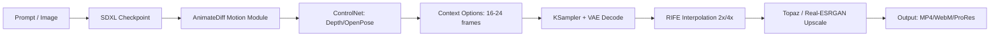

Скилл покрывает полный пайплайн создания видеоконтента с помощью генеративных моделей: от идеи и сториборда до готового рендера с апскейлом и постпродакшеном.

## Основные направления

- **Text-to-Video:** Генерация роликов по текстовому описанию (Runway Gen-3, Luma, Kling, Sora).
- **Image-to-Video:** Анимация статичных картинок с сохранением идентичности персонажей/объектов.
- **Video-to-Video:** Стилизация существующего видео, ротоскопинг, изменение стиля (Ebsynth, WarpFusion).
- **Loopable Video:** Создание бесшовных циклов для фонов, UI, Ambient-контента.
- **Motion Control:** Управление движением камеры, траекториями объектов через ControlNet Video / MotionCtrl.

## Инструменты и модели

| Категория | Инструменты |
|-----------|-------------|
| **Облачные (SOTA)** | Runway Gen-3 Alpha, Luma Dream Machine, Kling 1.5, Pika 1.5, Sora (ограниченный доступ) |
| **Локальные (Open Source)** | AnimateDiff (SD 1.5 / SDXL), SVD / SVD-XT, Hotshot-XL, CogVideoX, LTX-Video |
| **Управление движением** | ControlNet-Video, MotionCtrl, DragNUWA, CameraCtrl |
| **Апскейл / Качество** | Topaz Video AI, RIFE (интерполяция), Real-ESRGAN Video |

## Пайплайн制作 (ComfyUI + AnimateDiff)

## Лучшие практики

1. **Промптинг для видео:** Добавляйте дескрипторы движения: `slow motion`, `camera pan left`, `zoom in`, `parallax effect`.
2. **Согласованность:** Используйте IP-Adapter + ControlNet (Reference Only) для сохранения лиц/одежды.
3. **FPS:** Генерируйте на 8-12 FPS, интерполируйте до 30/60 через RIFE.
4. **Длина:** Большинство моделей дают 2-5 сек; стыкуйте через переходы или используйте Long Video модели (CogVideoX-5B).